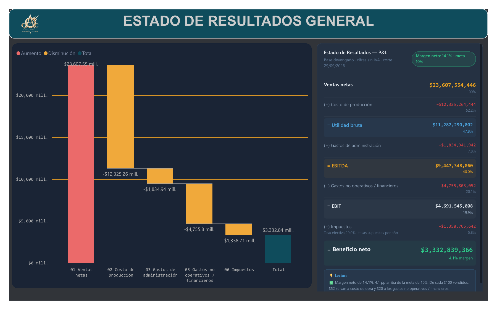
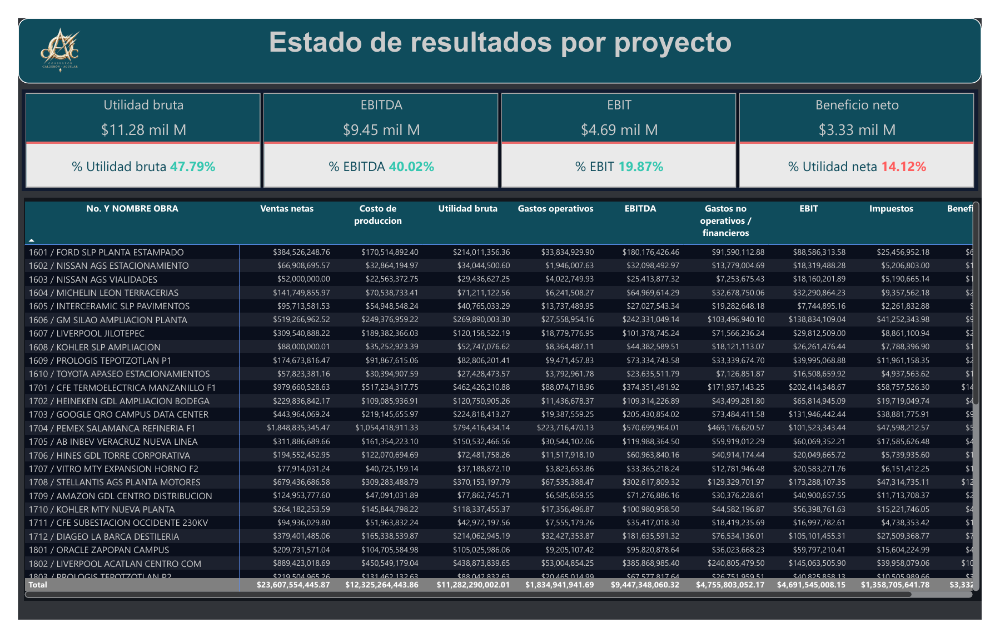
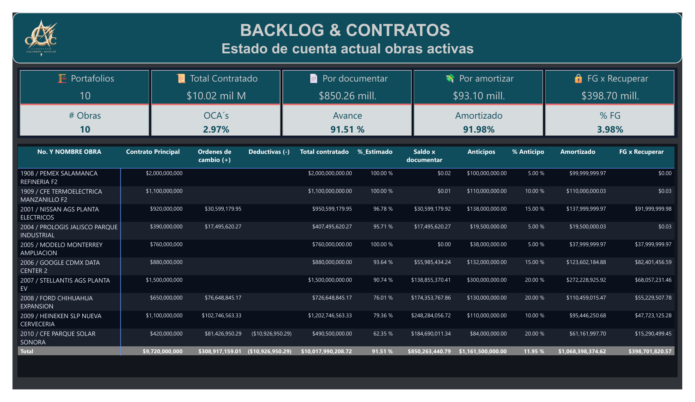
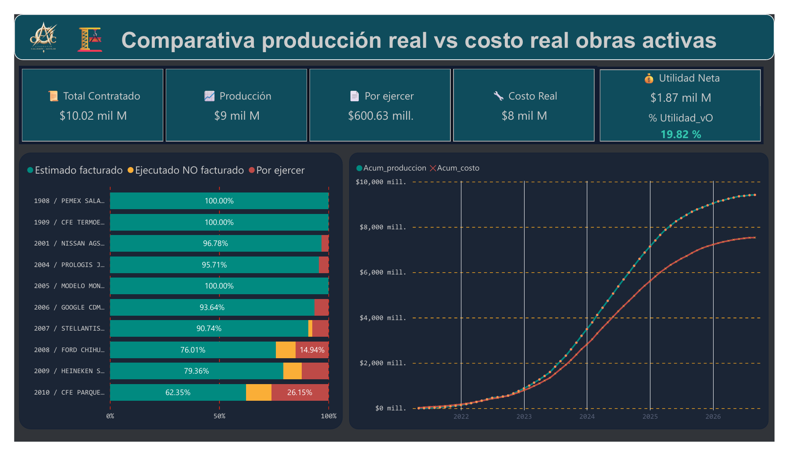
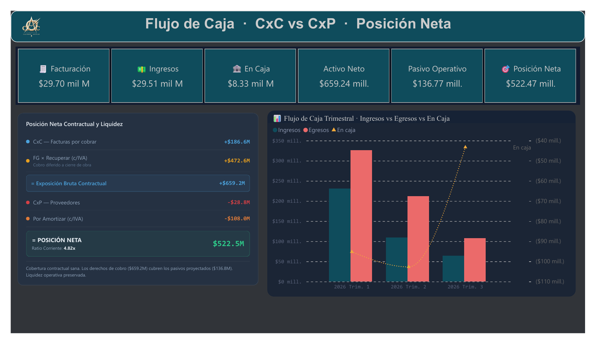
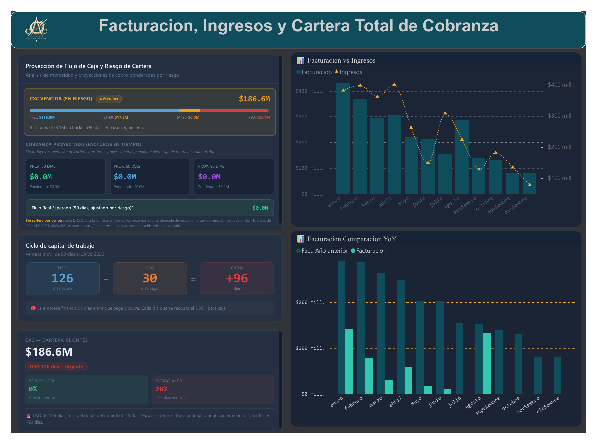
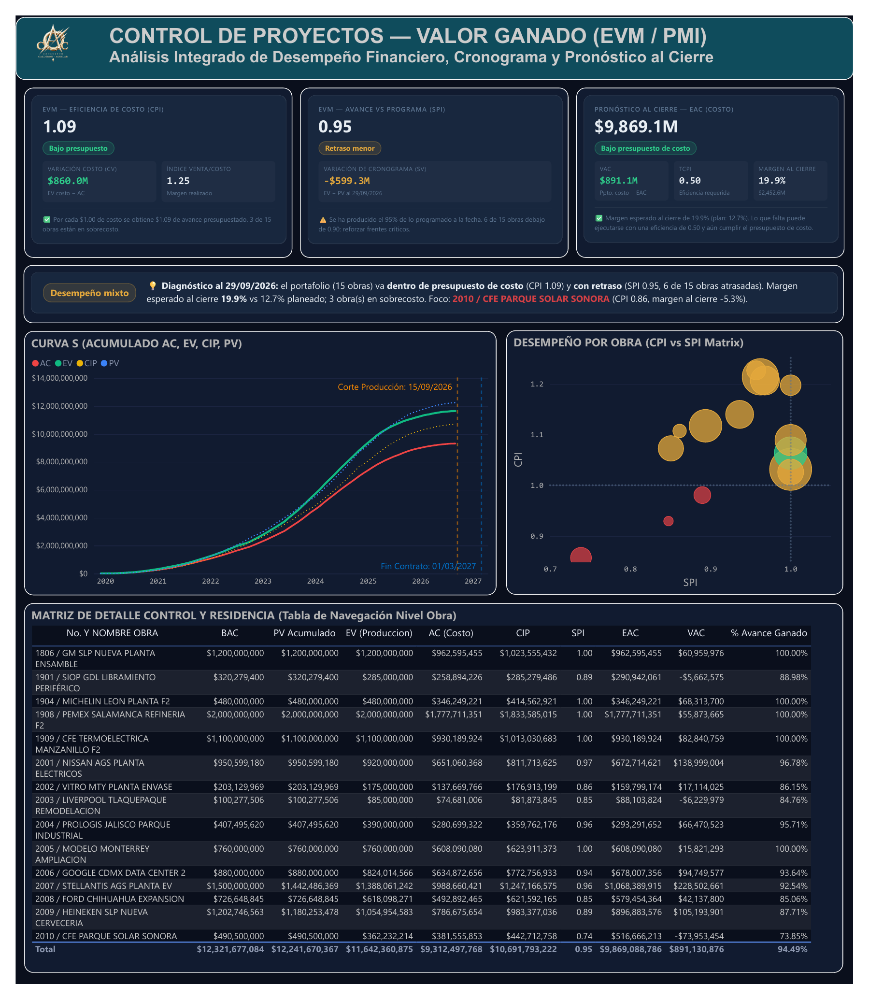
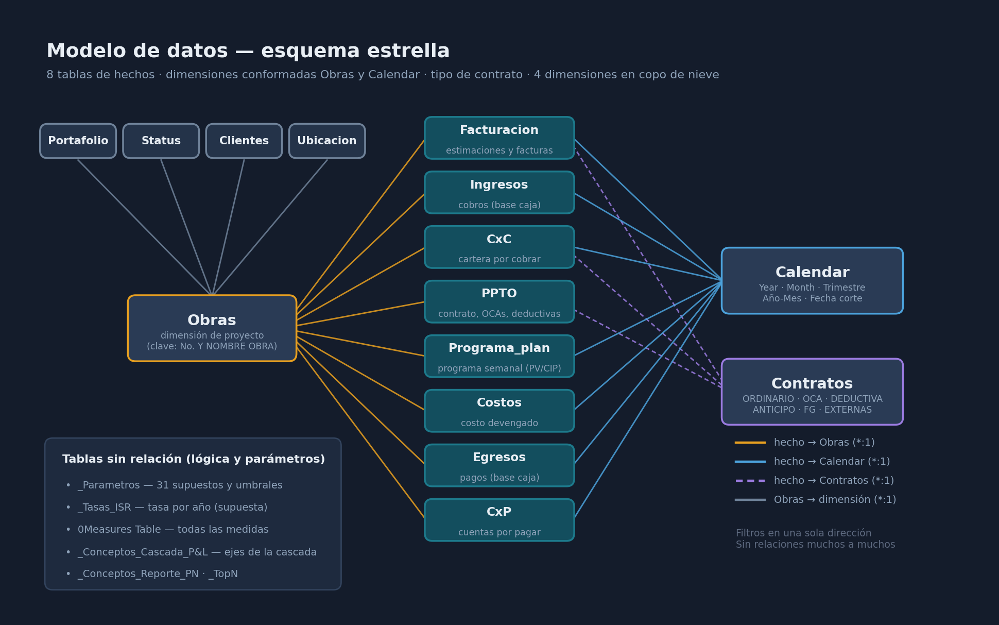
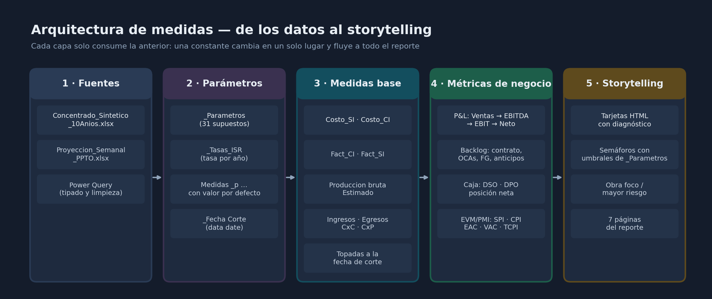

# Cuadro de Mando Financiero-Operativo de Obras

Tablero en Power BI para una constructora. En un solo modelo reúne:

- el estado de resultados;
- el backlog de contratos;
- la producción contra el costo de cada obra;
- el flujo de caja;
- la cartera de cobranza;
- el control de proyectos por valor ganado (EVM / PMI).

Cada página cierra con una lectura en texto que explica qué significa el número y qué hacer al respecto.



> **Datos sintéticos.** Las cifras son de ejemplo: 10 años y 47 obras generados para demostrar el modelo. Las tasas de impuesto por año también son supuestos.

---

## Qué responde el tablero

| Página | Pregunta de negocio |
|---|---|
| **Estado de resultados general** | ¿Cuánto gana la empresa y en qué se va cada peso vendido? |
| **Estado de resultados por proyecto** | ¿Qué obras aportan y cuáles destruyen margen? |
| **Backlog y contratos** | ¿Cuánto falta por ejecutar y documentar? ¿Cómo van anticipos, órdenes de cambio y fondos de garantía? |
| **Producción vs. costo** | ¿Alguna obra se está "comiendo" su utilidad antes de terminar? |
| **Flujo de caja y posición neta** | ¿Los derechos de cobro cubren las obligaciones? |
| **Cartera y cobranza** | ¿Qué tan vencida está la cartera y cuánto se espera cobrar a 30, 60 y 90 días? |
| **Valor ganado (EVM / PMI)** | ¿El portafolio va en tiempo y en presupuesto? ¿Con qué margen cerrará cada obra? |

El reporte completo en PDF está en [`docs/Cuadro de Mando Financiero-Operativo de Obras.pdf`](docs/Cuadro%20de%20Mando%20Financiero-Operativo%20de%20Obras.pdf).

<details>
<summary><b>Ver todas las páginas</b></summary>

### Estado de resultados por proyecto


### Backlog y contratos


### Producción real vs. costo real


### Flujo de caja y posición neta


### Facturación, ingresos y cartera


### Control de proyectos: valor ganado (EVM / PMI)


</details>

---

## Modelo de datos



- **8 tablas de hechos:** Facturacion, Ingresos, CxC, PPTO, Programa_plan, Costos, Egresos y CxP.
- **Dimensiones conformadas:**
  - `Obras`: todas las tablas de hechos se relacionan por obra.
  - `Calendar`: cada hecho usa su fecha natural. Por ejemplo, Egresos usa la **fecha de pago**, porque es base caja.
- **Dimensión de tipo de contrato** (`Contratos`), que filtra presupuesto, facturación y cartera.
- **Copo de nieve** bajo `Obras`: Portafolio, Status, Clientes y Ubicación.
- Todas las relaciones son de una sola dirección y ninguna es muchos a muchos. No hay registros de hechos sin obra.

## Arquitectura de medidas



Las medidas están en capas. **Ninguna constante de negocio vive dentro de una medida**: IVA, umbrales, ventanas de días, factores de cobranza y tasas de impuesto se leen de las tablas `_Parametros` y `_Tasas_ISR`. Cambiar un supuesto se hace en un solo lugar y el cambio llega a todo el reporte.

| Carpeta | Contenido |
|---|---|
| `99_Parametros` | Medidas `_p …` que leen `_Parametros` con valor por defecto, y `_Fecha Corte` |
| `01_Costos, CxP y egresos` | Costo sin IVA (`Costo_SI`), importe a pagar (`Costo_CI`), egresos |
| `02_Fact, CxC e ingresos` | Facturación con y sin IVA, cobros, cartera, cobros proyectados |
| `00_Metricas obra` | Contrato vigente, OCAs, deductivas, anticipos, fondo de garantía, avance |
| `03_Acumulados` | Acumulados desde el inicio, topados a la fecha de corte |
| `04_Comparativos de Tiempo` | Variaciones contra el mes anterior y el año anterior |
| `05_P&L` | Ventas netas → Utilidad bruta → EBITDA → EBIT → Beneficio neto |
| `06_Alertas y Semáforos` | DSO, DPO, ciclo de capital de trabajo, semáforos |
| `08_EVM (PMI)` | PV, EV, AC, SPI, CPI, EAC, ETC, VAC, TCPI, margen al cierre |
| `HTML` | Tarjetas de storytelling que usa el reporte |

---

## Criterios financieros y de PMI

| Tema | Criterio aplicado |
|---|---|
| **Reconocimiento de ingresos** | Devengado por avance de obra (NIF D-1 / IFRS 15). Las ventas netas son el valor de lo ejecutado **sin IVA**, neto de multas y deductivas. Lo ejecutado aún no facturado es opcional, con el parámetro `PL_Incluir_EnProceso`. |
| **Anticipos** | Son **pasivo**, no ingreso. Se muestran como "Por amortizar" en la posición neta. |
| **Fondo de garantía** | Se reconoce como ingreso en cada estimación. La factura de devolución **no** vuelve a contarse como venta. |
| **Costos del P&L** | Sin IVA y sin efecto de retenciones (`Costos[SUBTOTAL]`). El importe con IVA se usa solo para flujo y DPO. |
| **Impuestos** | Se calculan **año por año** (EBIT del año × tasa del año), así el total es aditivo. Los años con pérdida pagan 0. Las tasas son supuestos editables en `_Tasas_ISR`. |
| **Fecha de corte** | `_Fecha Corte` = hoy. Todo registro con fecha posterior se excluye de reales, acumulados y EVM. |
| **DSO / DPO** | Ventana móvil de 90 días a la fecha de corte; si no hubo movimiento, 365 días. El FG no infla el DSO. |
| **Cartera sana** | Solo cuenta la cartera **no vencida**. La cartera de 0–30 días ya está vencida. |
| **EVM** | CPI, CV, EAC, VAC y TCPI en **base costo**: el valor ganado se valúa al presupuesto de costo interno. El índice venta/costo se conserva aparte como `CPI Comercial`, que en realidad mide margen realizado. Todo se calcula obra por obra y luego se suma. |

---

## Medidas clave

<details>
<summary><b>Parámetro con valor por defecto (patrón usado en todo el modelo)</b></summary>

```dax
_p Tasa IVA =
VAR v =
    CALCULATE (
        MAX ( _Parametros[Valor] ),
        REMOVEFILTERS ( _Parametros ),
        _Parametros[Clave] = "Tasa_IVA"
    )
RETURN COALESCE ( v, 0.16 )   -- si alguien borra la clave, el modelo no se rompe
```
</details>

<details>
<summary><b>Ventas netas (devengado, sin IVA, sin anticipos ni FG)</b></summary>

```dax
Ventas netas =
VAR Corte = [_Fecha Corte]
VAR InclEnProceso = [_p PL Incluir En Proceso]
RETURN
    CALCULATE (
        SUM ( Facturacion[ESTIMADO] )
            + SUM ( Facturacion[MULTAS / DEDUCTIVAS] )
            + SUM ( Facturacion[MULTAS / DEDUCTIVAS2] ),
        KEEPFILTERS ( Facturacion[GRUPO] = "INGRESOS OPERATIVOS" ),
        KEEPFILTERS ( NOT Facturacion[CONTRATO] IN { "ANTICIPO", "FG" } ),
        KEEPFILTERS ( Facturacion[FECHA FACT.] <= Corte ),
        KEEPFILTERS ( InclEnProceso = 1 || Facturacion[No. FACTURA] <> "EN PROCESO" )
    )
```
</details>

<details>
<summary><b>Impuesto calculado año por año (aditivo)</b></summary>

```dax
Impuesto =
VAR TasaDefault = [_p ISR Tasa Default]
RETURN
    SUMX (
        VALUES ( 'Calendar'[Year] ),
        VAR Base = [EBIT]
        VAR Tasa =
            COALESCE (
                LOOKUPVALUE ( _Tasas_ISR[Tasa], _Tasas_ISR[Año], 'Calendar'[Year] ),
                TasaDefault
            )
        RETURN IF ( Base > 0, Base * Tasa )
    )
```
</details>

<details>
<summary><b>DSO con ventana móvil</b></summary>

```dax
_DSO Días =
VAR Corte = [_Fecha Corte]
VAR N = [_p DSO Ventana Dias]
VAR Saldo = CALCULATE ( [CxC], REMOVEFILTERS ( 'Calendar' ) )
VAR VentasN =
    CALCULATE ( [Fact_CI], REMOVEFILTERS ( 'Calendar' ),
        DATESBETWEEN ( 'Calendar'[Date], Corte - N + 1, Corte ) )
VAR Ventas365 =
    CALCULATE ( [Fact_CI], REMOVEFILTERS ( 'Calendar' ),
        DATESBETWEEN ( 'Calendar'[Date], Corte - 364, Corte ) )
VAR Dias = IF ( VentasN > 0, N, 365 )
VAR Base = IF ( VentasN > 0, VentasN, Ventas365 )
RETURN
    IF ( Base > 0 && NOT ISBLANK ( Saldo ), DIVIDE ( Saldo, Base ) * Dias )
```
</details>

<details>
<summary><b>Acumulado topado a la fecha de corte (curva S)</b></summary>

```dax
Acum_produccion =
VAR Corte = [_Fecha Corte]
VAR FechaMax = MIN ( MAX ( 'Calendar'[Date] ), Corte )
RETURN
    IF (
        MIN ( 'Calendar'[Date] ) <= Corte,
        CALCULATE ( [Produccion bruta], REMOVEFILTERS ( 'Calendar' ), 'Calendar'[Date] <= FechaMax )
    )
```
</details>

<details>
<summary><b>EVM en base costo: valor ganado, CPI y EAC obra por obra</b></summary>

```dax
EV_Interno =
SUMX (
    VALUES ( Obras[No. Y NOMBRE OBRA] ),
    VAR Cip = [CIP_BAC]          -- presupuesto de costo total de la obra
    VAR Bac = [Contratado_SI]    -- contrato vigente sin IVA
    RETURN
        IF ( NOT ISBLANK ( Cip ) && Bac > 0,
             MIN ( 1, DIVIDE ( [Acum_produccion], Bac ) ) * Cip )
)

CPI = DIVIDE ( [EV_Interno], [AC EVM] )

EAC =
SUMX (
    VALUES ( Obras[No. Y NOMBRE OBRA] ),
    VAR Cip = [CIP_BAC]
    RETURN
        IF ( NOT ISBLANK ( Cip ),
            VAR Ac  = COALESCE ( [Acum_costo], 0 )
            VAR Ev  = MIN ( COALESCE ( [EV_Interno], 0 ), Cip )
            VAR Cpi = DIVIDE ( Ev, Ac )
            VAR Etc = IF ( Cpi > 0, DIVIDE ( Cip - Ev, Cpi ), Cip - Ev )
            RETURN Ac + MAX ( 0, Etc )
        )
)

Margen Proyectado al Cierre =
SUMX (
    VALUES ( Obras[No. Y NOMBRE OBRA] ),
    IF ( NOT ISBLANK ( [CIP_BAC] ), [Contratado_SI] - [EAC] )
)
```
</details>

---

## Parámetros configurables (extracto)

Se editan en la tabla calculada `_Parametros`, que tiene 31 claves.

| Clave | Valor | Uso |
|---|---|---|
| `Tasa_IVA` | 0.16 | Conversión entre importes con y sin IVA |
| `ISR_Tasa_Default` | 0.30 | Tasa para años que no están en `_Tasas_ISR` (supuesto) |
| `PL_Incluir_EnProceso` | 1 | 1 = el P&L reconoce lo ejecutado aún no facturado |
| `Margen_Meta` / `Margen_Alerta` | 0.10 / 0.08 | Colores y lectura del margen neto |
| `DSO_Ventana_Dias` | 90 | Ventana móvil de DSO y DPO |
| `DSO_Umbral_Privado` | 45 | Umbral de días de cobro |
| `Forecast_Efectividad_30/60/90` | 0.95 / 0.88 / 0.80 | Ponderación del cobro proyectado (supuesto) |
| `EVM_CPI_Alerta` / `EVM_SPI_Alerta` | 0.95 / 0.90 | Semáforos de valor ganado |
| `EVM_TCPI_Riesgo` | 1.10 | Eficiencia requerida considerada poco realista (PMBOK) |

---

## Contenido de este repositorio

```
├── README.md
└── docs/
    ├── Cuadro de Mando Financiero-Operativo de Obras.pdf   ← reporte completo (7 páginas)
    └── img/                                                ← capturas y diagramas de este README
```

Este repositorio documenta el diseño, la metodología y los resultados del tablero. El archivo de Power BI (`.pbip`) y las fuentes de Excel no se publican.

## Limitaciones conocidas

- **Datos sintéticos:** en la fuente, la amortización del anticipo no se descuenta del importe facturado. Algunos registros tienen fecha posterior al corte; el modelo los excluye automáticamente.
- **Tasas de impuesto y factores de cobranza:** son supuestos y deben validarse contra datos reales.
